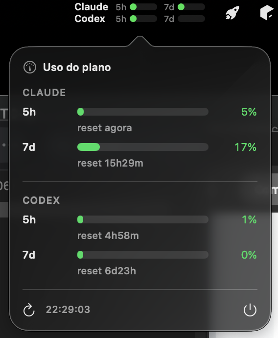

🇬🇧 English | [🇧🇷 Português](README.pt-BR.md)

# AI Usage Bar

A tiny native macOS **menu bar** app that shows your **Claude Code** and **Codex** plan
rate-limit windows in real time, with reset countdowns.



```
Claude 5h▕██░░░░░▏ 7d▕█░░░░░░▏
Codex  5h▕███░░░░▏ 7d▕░░░░░░░▏
```

- Two rows (Claude + Codex), two bars each: **5h** rolling window and **7d** window.
- Bars fill with **% used** and change color: green &lt;80%, orange ≥80%, red ≥95%.
- Hover for exact `%` + reset time; click for a popover with the full breakdown.
- No dashboards, no extra login — it reuses the tokens your CLIs already store.

> Inspired by the data-collection recipe of
> [oauramos/claude-usage-stick](https://github.com/oauramos/claude-usage-stick) (an ESP32
> hardware monitor). This is an independent macOS re-implementation in Swift. The switch to the
> `/api/oauth/usage` endpoint and the last-usage cache came from
> [LucasM-Maciel/ticlins-claude-monitor](https://github.com/LucasM-Maciel/ticlins-claude-monitor).

## Requirements

- macOS 13+
- Xcode **Command Line Tools** (`xcode-select --install`) — no full Xcode needed
- [Claude Code](https://claude.com/claude-code) and/or [Codex CLI](https://developers.openai.com/codex/cli)
  installed and logged in (that's where the tokens come from)

## Install

```bash
git clone https://github.com/rafaelmgbh/ai-usage-bar.git
cd ai-usage-bar
./build.sh
open ~/Applications/AiUsageBar.app
```

No Keychain prompt is expected: items are read through `/usr/bin/security` (see below). If macOS
ever asks, click **Always Allow** — it is granted to `security`, so it survives rebuilds.
Since you build it yourself, Gatekeeper lets it run.

### Why rebuilds don't ask for the Keychain password

The app reads Keychain items through `/usr/bin/security` instead of calling the Keychain API
itself. Claude Code creates its credential items with that same tool, so `security` is already
trusted by them (trusted-apps list + `apple-tool:` partition). Reading directly would tie access to
the app's own code signature — the cdhash, which changes on every `./build.sh` — and macOS would ask
for your Keychain password again after each rebuild.

### Start at login (optional)

```bash
./autostart.sh on     # enable
./autostart.sh off    # disable
```

### Multiple Claude accounts (optional)

Claude Code keeps one profile per config dir — `CLAUDE_CONFIG_DIR=~/.claude-work claude` signs you
in as a separate account — and each profile's token lands in its **own** Keychain item. AI Usage Bar
can watch several at once, one menu bar row per account.

Create `~/.config/ai-usage-bar/accounts.json`:

```json
{
  "claudeAccounts": [
    { "label": "Personal" },
    { "label": "Work", "configDir": "~/.claude-work" }
  ]
}
```

- Omit `configDir` for the default profile (`~/.claude`).
- The label is what shows up in the menu bar — keep it short.
- Without the file the app behaves exactly as before: a single Claude row.

Every account is queried with its own token and the usage comes back from whichever account
authenticated, so it can't be attributed to the wrong one. From 3 rows on, the font and
bars shrink to fit the menu bar's fixed height.

### Turn monitors on/off

Every section in the popover has a switch. Turning a monitor off hides its menu bar row and stops
querying it (a Claude account off = no request). The choice is remembered across restarts;
turning it back on refreshes that monitor right away. With everything off the menu bar shows a
dim `AI` so you can still open the popover.

### API balances: DeepSeek and Jev (optional)

Balances show up in the popover and the tooltip only — they are amounts, not percentages, so they
stay out of the menu bar. Each one is opt-in in `accounts.json`:

```json
{
  "claudeAccounts": [ { "label": "Personal" } ],
  "deepseek": { "keychainService": "DEEPSEEK_API_KEY", "alertBelow": 1 },
  "jev": { "creditUSD": 10, "since": "2026-09-30", "alertBelow": 1 }
}
```

- **DeepSeek** — `GET api.deepseek.com/user/balance` (read-only, free). The API key lives in a
  generic Keychain item (`DEEPSEEK_API_KEY` by default):
  `security add-generic-password -s DEEPSEEK_API_KEY -a "$USER" -w` (prompts for the key).
- **Jev** ([TypeSafe](https://typesafe.ai)) — the API has **no balance endpoint**, so the balance is
  *estimated*: `creditUSD` minus the `custo_usd` the [`jev`](https://github.com/rafaelmgbh/jev) CLI
  logged in `~/.local/share/jev/decisions.db` since `since` (`YYYY-MM-DD`, the top-up day). Only
  calls made from this Mac are counted. Without `creditUSD` it shows this month's spend only.
- `alertBelow` (default 1): the balance turns orange below it, red at zero / unavailable.

## How it works

| Provider | Token source | Endpoint | Quota cost |
|---|---|---|---|
| **Claude** | macOS Keychain, per profile (`Claude Code-credentials[-<sha256(configDir)[0:8]>]` → `claudeAiOauth.accessToken`) | `GET api.anthropic.com/api/oauth/usage` (same endpoint as `/usage`) → `five_hour`/`seven_day` `{utilization,resets_at}` + per-model weekly caps from `limits[]`. Falls back to a `max_tokens:1` Messages API probe (rate-limit headers) if that endpoint disappears | **none** (status endpoint; the fallback costs a tiny request) |
| **Codex** | `~/.codex/auth.json` (`tokens.access_token` + `account_id`) | `GET chatgpt.com/backend-api/wham/usage` → `rate_limit.{primary,secondary}_window.{used_percent,reset_at}` | **none** (status endpoint) |
| **DeepSeek** *(opt-in)* | Keychain generic item (`DEEPSEEK_API_KEY`) | `GET api.deepseek.com/user/balance` → `balance_infos[].total_balance` | **none** |
| **Jev** *(opt-in)* | — | local SQLite `~/.local/share/jev/decisions.db` → `SUM(custo_usd)` | **none** (no network) |

Refreshes every 5 minutes. The token is re-read each cycle, so when the CLI refreshes it the
app picks it up automatically. The last good Claude usage of each account is cached in
`~/Library/Caches/io.github.rafaelmgbh.ai-usage-bar/claude-usage.json`: the app opens with it
(dimmed until the first refresh), and when a refresh fails (offline, 429, expired token) it keeps
showing it with its time — windows that have reset since then drop to 0%.

Source layout:

| File | Role |
|---|---|
| `AccountsConfig.swift` / `KeychainService.swift` | which accounts/balances to watch + each one's Keychain item name |
| `MonitorPrefs.swift` | which monitors are switched off (UserDefaults) |
| `Balance.swift` / `JevLedger.swift` | parse the DeepSeek balance; sum Jev spend from its local log |
| `DeepSeekProbe.swift` | DeepSeek: read API key + `user/balance` |
| `ClaudeUsage.swift` / `UsageCache.swift` | parse `/api/oauth/usage`, zero windows that already reset; last-usage cache on disk |
| `Keychain.swift` / `UsageProbe.swift` | Claude: read token + `/api/oauth/usage` (Messages API probe as fallback) |
| `CodexProbe.swift` | Codex: read `auth.json` + `wham/usage` |
| `UsageModel.swift` | observable state; refreshes every enabled monitor in parallel |
| `AppDelegate.swift` | `NSStatusItem` (drawn 2-row image) + `NSPopover` + 5-min timer |
| `PopoverView.swift` | SwiftUI popover with both sections |
| `main.swift` | `NSApplication` in `.accessory` mode (no Dock icon) |

## Privacy & caveats

- Tokens are read **locally** and only ever sent to the provider's own endpoint. Tokens are
  never stored, logged, or sent anywhere else; only the usage numbers are cached on disk.
- It uses your **subscription** token — fine for personal use; you are responsible for your
  provider's Terms of Service.
- The app is **not** signed/notarized for distribution (build it yourself).
- If a row shows `token expired`, just open Claude Code / run `codex` once so the CLI refreshes
  the token.

## Related / alternatives

If you'd rather use a polished, maintained, multi-provider tool:
- [steipete/CodexBar](https://github.com/steipete/codexbar) — Codex + Claude + 40 providers, native widgets
- [Nihondo/AgentLimits](https://github.com/Nihondo/AgentLimits) — WidgetKit + ccusage

## License

[MIT](LICENSE) © Rafael Araujo. Inspired by
[oauramos/claude-usage-stick](https://github.com/oauramos/claude-usage-stick) (MIT) and
[LucasM-Maciel/ticlins-claude-monitor](https://github.com/LucasM-Maciel/ticlins-claude-monitor) (MIT).
